# MeetRa

<p align="center">
  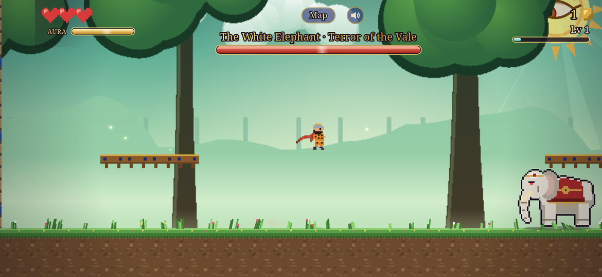
</p>

<p align="center">
  <b>A mobile action-adventure platformer in the spirit of Swordigo, with a light breeze of Persian epic poetry.</b><br>
  Built with Flutter and Flame · landscape, touch-first · Android and iOS
</p>

A young guardian named **Ra** walks the old **Road of Seven Trials** to win back the stolen Dawnfire from the Pale Giant. Seven realms, 140 places, beasts out of old Persian lore, and a great sun with an eye that watches Ra wherever he goes.

## Screenshots

<table>
  <tr>
    <td>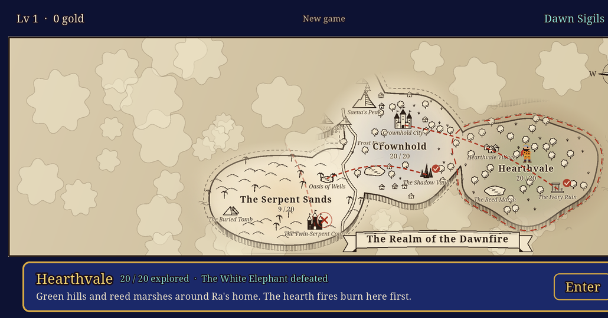</td>
    <td>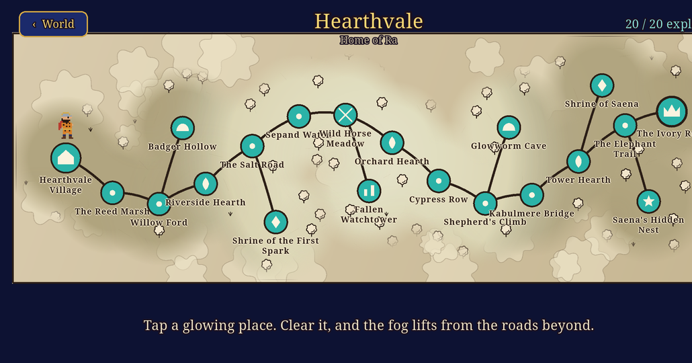</td>
  </tr>
  <tr>
    <td align="center"><sub><b>The world map</b>, in ink on old paper, under fog of war</sub></td>
    <td align="center"><sub><b>A realm map</b>: 20 places, a road that opens as you clear it</sub></td>
  </tr>
  <tr>
    <td>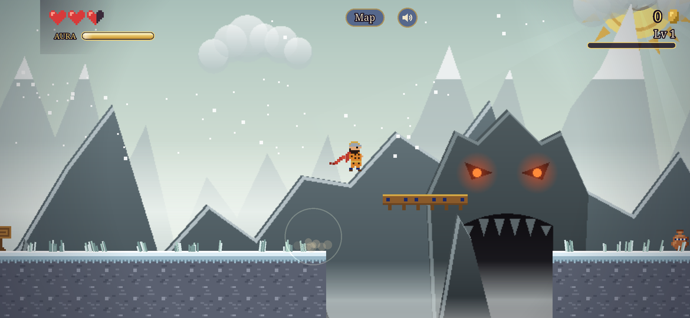</td>
    <td>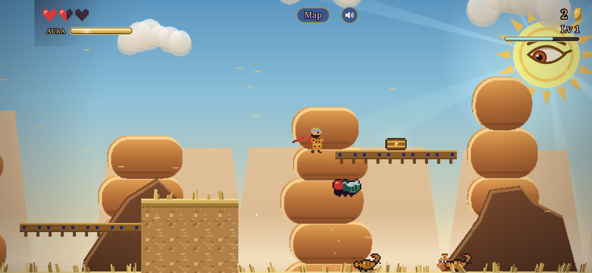</td>
  </tr>
  <tr>
    <td align="center"><sub><b>Sky Spine & Frostwood</b>: a demon hewn into the peaks, its eyes still glowing</sub></td>
    <td align="center"><sub><b>The Serpent Sands</b>: a canyon of balanced rock pillars</sub></td>
  </tr>
  <tr>
    <td>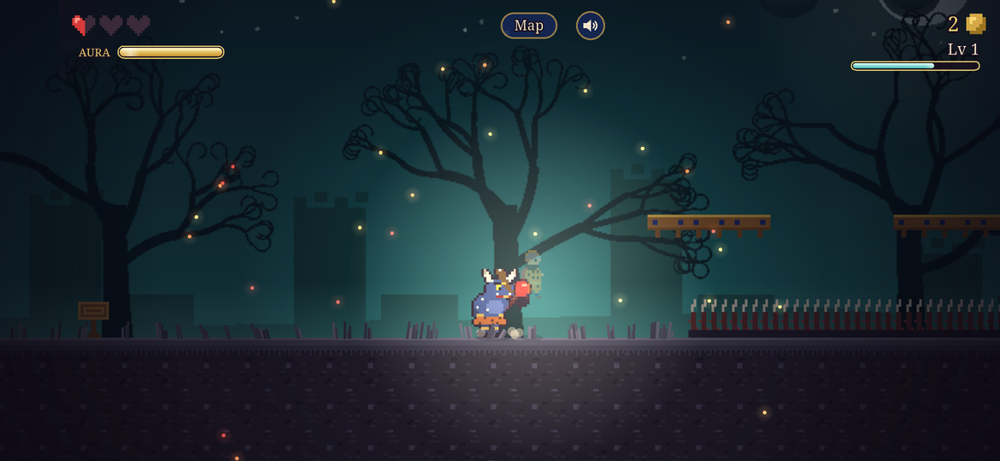</td>
    <td>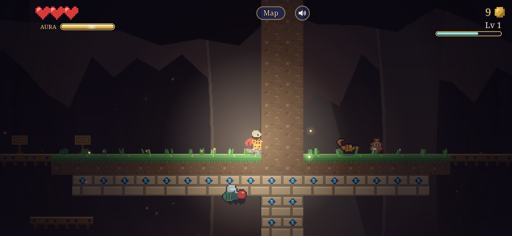</td>
  </tr>
  <tr>
    <td align="center"><sub><b>The Lightless Land</b>: dead trees curling under a pale moon</sub></td>
    <td align="center"><sub><b>Underground</b>: below the surface rooms, a cavern of glowing crystals</sub></td>
  </tr>
  <tr>
    <td>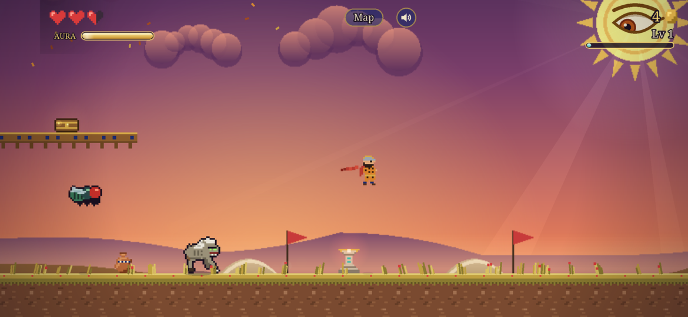</td>
    <td>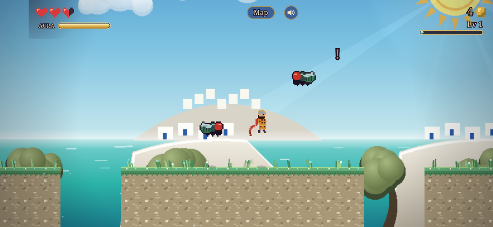</td>
  </tr>
  <tr>
    <td align="center"><sub><b>The Duskland</b>: the Khan's tents under a red evening</sub></td>
    <td align="center"><sub><b>The Marble West</b>: white houses over a turquoise sea</sub></td>
  </tr>
  <tr>
    <td>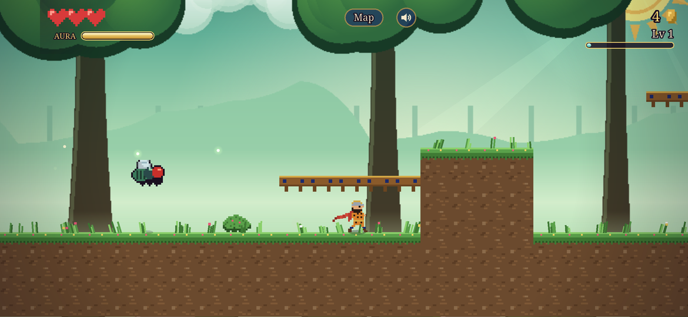</td>
    <td>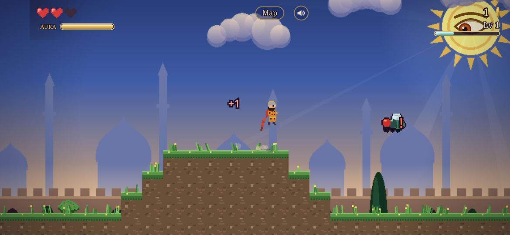</td>
  </tr>
  <tr>
    <td align="center"><sub><b>Hearthvale</b>: old trees round a sunlit glade</sub></td>
    <td align="center"><sub><b>Crownhold</b>: domes and towers behind the city wall</sub></td>
  </tr>
</table>

## Status: playable prototype (v1.1.0)

### The world

- **7 realms** on a world map, each with its own map of **20 places** (140 in all): towns, hearths, trails, caves, shrines, ruins, an arena, a realm boss and a secret place.
- Clearing a place opens its neighbours; beating a realm's boss opens the next realm. The 7th realm, **the Lightless Land**, stays hidden until all six **Dawn Sigils** (one per secret place) are found.
- Every realm has its own **painted backdrop** in five parallax layers, plus its own ground, grass and weather: a forest glade, a domed city, a canyon of rock pillars, misty peaks with a demon carved in the rock, the steppe at dusk, white sea cliffs and a moonlit waste of dead trees.
- Going down into the rooms below the surface, the sky fades into an **underground cavern** of hanging stone and glowing crystals.
- Levels are **rooms to explore**: doors, drops through the floor, climbs back up. The way out is sealed until Ra finds the **Sun Key**, hidden in the room farthest from the start.
- The Reed Marsh is the hand-made tutorial; the other places are built from level chunks and get harder realm by realm.
- Progress is saved on the phone.

### Fighting

- Walking, variable-height jumps, **double jump**, coyote time and jump buffering
- **3-hit sword combo**, down-strike (pogo), hitstop and screen shake
- **Saena's Feather** spell and the **Aura** bar
- XP, levelling and a **Heart / Might / Aura** choice
- Gold, breakable vases and bushes, hidden chests, heart drops
- **Hearth** checkpoints that also heal you; pits and thorns send you back to the last safe ground

### Creatures from old Persian lore

| Creature | How it fights |
|---|---|
| Horned demon | Patrols, charges when it sees Ra, raises its club and lunges |
| Carrion fly | Hovers lazily, then buzzes after Ra in a zigzag |
| Ghoul of the waste | Lies buried as a heap of sand, bursts out and pounces |
| Scorpions | Small and quick, they come in pairs and dart in with the sting |
| Man-eater | A huge red lion with a scorpion's tail: roars, then charges; blows barely push it |
| **The Reed Lion** (boss) | Charges, stuns itself on walls, pounces; enraged at half health |
| **The White Elephant** (boss) | Stamps shockwaves along the ground and charges with its tusks |

### Look and sound

- Soft painted backdrops behind crisp pixel art, sun rays and the **Eye of Ra** watching from the sun
- A living world: grass that sways and parts around feet, weather for each realm (pollen and fireflies, dust, sand, snow, leaves, sea spray, embers), glowing hearths, darkness and light in caves and the Lightless Land
- Juice: Ra's flowing scarf, breathing, landing squash and dust; hit sparks, shockwave rings, popping damage numbers, screen flashes
- Procedural music in Persian modes: a santur and daf theme for exploring (Shur) and a tense boss theme (Chahargah)
- Landscape lock and fullscreen on Android and iOS, drawn under the camera cutout

All art and sound are generated from code. Final art arrives in M1.

## Getting started

Requires [Flutter](https://docs.flutter.dev/get-started/install) (3.29 or newer) and [Android Studio](https://developer.android.com/studio) with an emulator, or a phone with USB debugging.

```bash
flutter pub get
flutter emulators --launch Pixel_8_Pro_API_29   # or any AVD, or plug in a phone
flutter run
```

In VS Code, install the recommended extensions when prompted, pick **MeetRa (debug)** and press **F5**. Press `r` in the terminal (or save a file) to hot reload.

On a computer the keyboard works too (see Controls). iOS needs a Mac with Xcode: `flutter run` on an iOS simulator.

Run the tests with `flutter test`.

### Screenshots

The `SHOT` dev mode skips the title and tours scenes, 15 seconds each, with Ra walking, jumping and swinging on his own and the touch buttons hidden:

```bash
flutter run --release --dart-define=SHOT=world,realm:0,0:13,2:4
```

`world` and `realm:N` open the maps; `R:P` enters place `P` of realm `R` (13 is the realm boss).

## Controls

| Action | Phone | Keyboard (dev) |
|---|---|---|
| Walk | ◀ ▶ | ← → / A D |
| Jump / double jump | ▲ | Space / ↑ / W |
| Sword combo | ⚔ | J / X |
| Down-strike | Hold ▼ in mid-air + ⚔ | ↓ + J |
| Drop through platform | Hold ▼ + ▲ | ↓ + Space |
| Saena's Feather | ✦ | K / C |
| Level-up choice | Tap a card | 1 / 2 / 3 |

## Documents

- [Swordigo analysis](docs/01-swordigo-analysis.md): a detailed breakdown of the reference game
- [Game design document](docs/02-game-design.md): story, the seven trials, mechanics, mobile design, roadmap
- [Saga Bible (PDF)](docs/MeetRa-Saga-Bible.pdf): a game scenario for every story of the Shahnameh, plus the world map. Rebuild with `python docs/saga/build.py`.

## Project structure

```
lib/
  main.dart            App, landscape fullscreen, UI layered over the game
  config.dart          Constants, player tuning, GameState
  input.dart           Merges keyboard and touch input
  sfx.dart             Sound effects synthesized to WAV at startup
  music.dart           Procedural santur and daf music, rendered in a background isolate
  art/                 Art generated from code: pixel sprites and tiles, painted backdrops
  levels/              ASCII level builder, the hand-made tutorial, rooms and the level generator
  world/               The 7 realms × 20 places, unlock rules and the save file
  entities/            Player, enemies (demon, fly, ghoul, scorpion, man-eater), Lion and Elephant bosses
  game/                MeetRaGame (loop, camera, render), arcade physics, effects, ambience (grass, weather, lights)
  ui/                  HUD, menus, world and realm maps, touch buttons
test/                  Unit tests (level builder, physics, world and unlocks)
android/, ios/         Native platform projects
docs/                  Design documents and screenshots
```

To add a level, write an ASCII map in `lib/levels/`. The character legend is in `build.dart`.

## Tech

[Flutter](https://flutter.dev) and [Flame](https://flame-engine.org), with [audioplayers](https://pub.dev/packages/audioplayers) for sound.
